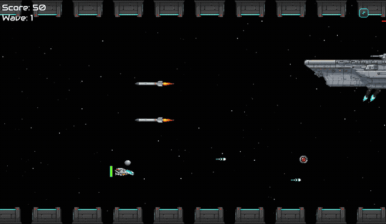
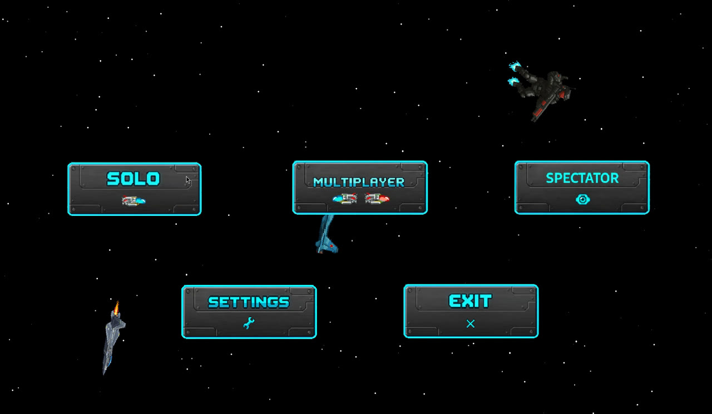
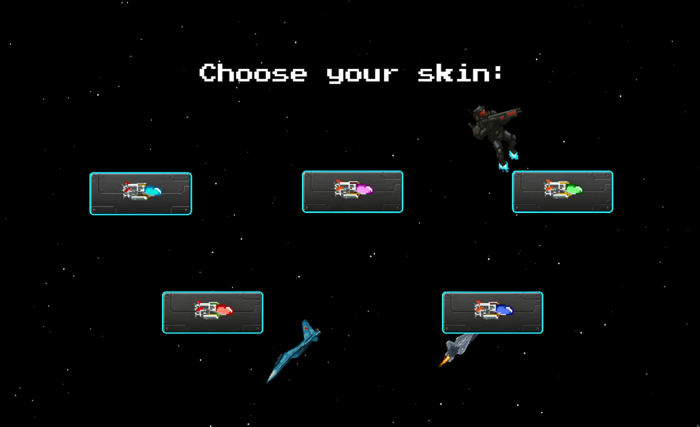
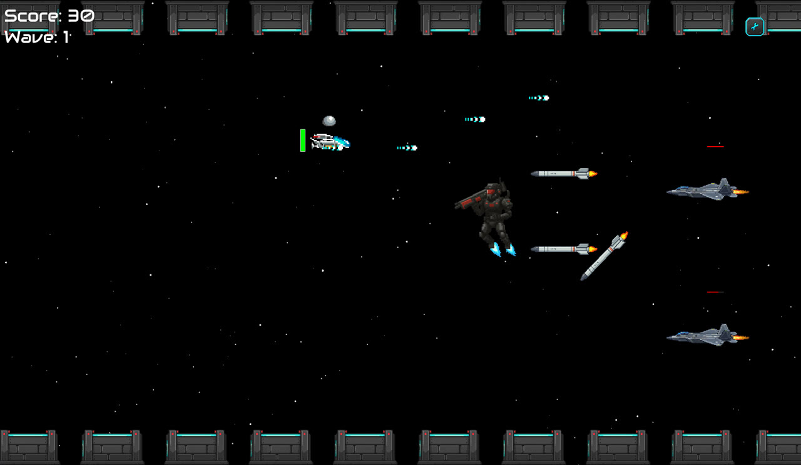
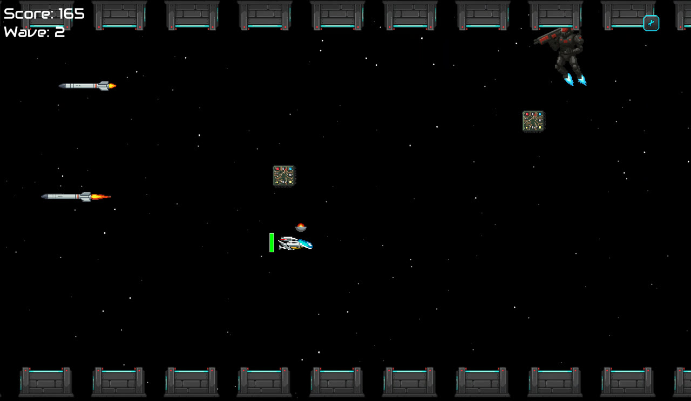

# R-Type — shoot'em up multijoueur en réseau, moteur ECS en C++ (Epitech, 3e année)

> **EN** — A networked multiplayer shoot'em up in C++17 (Epitech, Sept.–Nov. 2025, team of 6). An authoritative
> server built on our own ECS engine runs the game and talks to SFML clients over a **custom binary UDP protocol**.
> I was the network lead: protocol design, UDP server and client, client-side prediction and reconciliation of
> shots, delta updates, heartbeat and disconnections, and most of the server-side game systems.

**R-Type** reprend le principe du shoot'em up à défilement horizontal des années 80 : un vaisseau, des vagues
d'ennemis qui tirent des missiles, un boss, des modules à ramasser. Le projet impose deux choses : jouer **à
plusieurs en réseau**, et construire le jeu sur **notre propre moteur** à base d'ECS (Entity–Component–System).
Le serveur est autoritaire : c'est lui qui fait tourner la partie, les clients affichent et envoient les touches.

🎬 Vidéo d'une partie solo (70 s) : menu, choix du vaisseau, vague 1, le boss, puis la vague 2 : [media/gameplay.mp4](media/gameplay.mp4)

| Menu principal | Choix du vaisseau |
| --- | --- |
|  |  |
| **En partie** | **Vague 2** |
|  |  |

## Le jeu

- **Modes** : solo, multijoueur et spectateur ; trois difficultés.
- **Ennemis** : chasseurs qui tirent des missiles, missiles à tête chercheuse, ennemis fixes, un **boss** porte-avions
  qui lance ses propres chasseurs, et une IA humanoïde qui ramasse des objets, attrape des ennemis pour les lancer
  et se duplique.
- **Tir chargé** : plus on maintient `Espace`, plus le tir est puissant (six niveaux).
- **Vagues** : murs qui défilent en haut et en bas, vagues d'ennemis de plus en plus fournies, modules à ramasser
  qui changent l'arme, score et vague affichés en haut à gauche.
- **Accessibilité** : manette, remappage des touches, filtres pour daltoniens.

## Le réseau (ma partie)

Tout passe par **UDP** avec un protocole binaire maison : un octet d'identifiant, puis des champs de taille fixe.
Une quarantaine de paquets (connexion, menus, positions, tirs, impacts, ennemis, IA, score). Détail :
[docs/PROTOCOL.md](docs/PROTOCOL.md).

- **Serveur autoritaire** : positions, tirs, collisions, dégâts, vagues et score sont calculés côté serveur, puis
  envoyés à tous les clients. Un client ne peut pas tricher sur sa position ou ses dégâts.
- **Prédiction côté client** : le vaisseau et les tirs du joueur bougent tout de suite à l'écran, sans attendre
  le serveur. Chaque tir porte un horodatage ; le serveur le confirme (il reçoit alors son identifiant réseau) ou
  le rejette, et le client se recale (*reconciliation*).
- **Paquets delta** : les positions des tirs et des missiles sont envoyées en continu, en paquets courts, et le
  client lisse les écarts par interpolation.
- **Heartbeat** : chaque client envoie un battement régulier ; le serveur mesure la latence et déconnecte proprement
  un joueur qui ne répond plus.
- **Banc d'essai** : un script `simulate_lag.sh` (`tc` / `netem`) ajoute latence, gigue, pertes et désordre sur
  la boucle locale pour tester le jeu dans de mauvaises conditions réseau.
- **Multiplateforme** : sockets POSIX sous Linux, Winsock sous Windows, avec une CI GitHub Actions qui compile
  et teste.

## Le moteur

- **Serveur** : un ECS maison (`World`, pools de composants, bus d'événements) dont les systèmes sont rangés par
  **phases** exécutées dans l'ordre à chaque tour : réception réseau, heartbeat, entrées, logique, physique,
  collisions, envoi. Les modules de jeu (joueurs, tirs, ennemis, IA, murs, modules, vagues) s'y branchent.
- **Client** : un registre ECS à tableaux creux (`sparse_array`), des systèmes de rendu, d'animation, de son et
  de prédiction, et un gestionnaire de paquets qui traduit chaque message réseau en composants.

Architecture : [docs/ARCHITECTURE.md](docs/ARCHITECTURE.md) · Installation : [docs/INSTALL-fedora.md](docs/INSTALL-fedora.md)

## Technique

- C++17, CMake, Conan, SFML 2.6 ; environ 11 000 lignes côté serveur et 15 000 côté client.
- Linux et Windows ; tests GoogleTest, CI GitHub Actions, documentation Doxygen et MkDocs, protocole décrit dans
  un document au format RFC.

## Mon rôle

Projet à **six** (septembre–novembre 2025) avec Olaf Breitenbucher, Brice Laurent, Thibaut Louis, Raphaël Gall et
Sami Kandil. J'étais le **référent réseau** et j'ai fait 198 des 640 commits :

- le protocole binaire (trois versions successives) et sa documentation ;
- la couche UDP du serveur et du client, Linux et Windows, connexion et déconnexion des joueurs, salle d'attente,
  partie pleine ou déjà lancée, pause et reprise ;
- la prédiction et la réconciliation du joueur et de ses tirs, les paquets delta, le heartbeat ;
- côté serveur : déplacement des joueurs, tirs, collisions et dégâts, murs, modules, envoi des ennemis et de leurs
  missiles, portage sur le serveur des systèmes de l'IA humanoïde ;
- l'outil de simulation de latence, la CI et les correctifs de compilation multiplateforme.

Mes coéquipiers ont écrit le moteur ECS, le rendu et les menus du client, les ennemis et le boss, l'IA humanoïde
et l'accessibilité.

Pour cette présentation, j'ai corrigé deux bugs restés dans la version rendue : des tirs qui restaient figés à
l'écran quand un message de suppression se perdait, et le score qui n'était plus envoyé au client après une fusion.

## Code source

Le code source et son historique complet sont dans un dépôt privé :
[FuniclemDev/rtype-source](https://github.com/FuniclemDev/rtype-source) (accès sur demande).
Ce dépôt public ne contient que la présentation, la documentation et les médias : le code des projets Epitech
n'est pas publié en accès libre.

---
Clément Dorge · [clementdorge.com](https://clementdorge.com/fr/projets/r-type/) · Epitech Strasbourg
